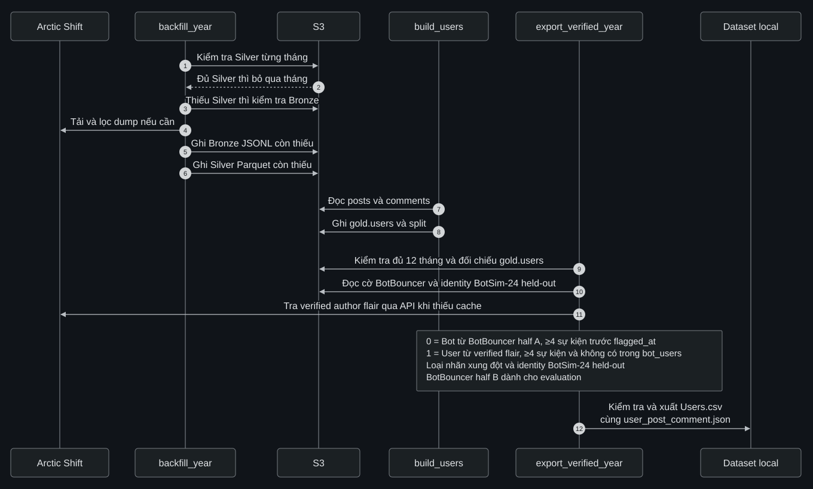

# Reddit Bot Detection Dataset

Dataset này dùng để huấn luyện và đánh giá mô hình phân loại **tài khoản Reddit** thành **Bot (0)** hoặc **User (1)**. Mỗi mẫu gồm một tài khoản, lịch sử bài đăng và bình luận của tài khoản đó trong các subreddit được chọn, cùng một nhãn. Dữ liệu hoạt động đến từ 15 subreddit về tin tức và chính trị, như r/politics, r/news và r/worldnews.

**Bản dataset mới nhất** bao phủ **09/2025–08/2026** và có **2.078 tài khoản**, gồm **1.374 Bot** và **704 User**. Hai file dữ liệu cùng báo cáo nằm trong thư mục [`dataset/`](dataset/).

## Hai file dataset

- **`Users.csv`** có một dòng cho mỗi tài khoản và đúng chín cột theo BotSim-24, gồm thông tin tài khoản, số bài đăng, số bình luận và danh sách subreddit.
- **`user_post_comment.json`** lưu lịch sử theo `user_id`. Mỗi tài khoản có `posts` (bài đăng), `comment_1` (bình luận trả lời bài đăng) và `comment_2` (reply cho bình luận). `comment_2` có `level` và `levels`. Cả hai là `null` khi thiếu chuỗi parent để xác định độ sâu.

Đọc `counts_by_label.User` trong `report.json` trước khi sắp xếp CSV. Với bản hiện tại, **704 dòng dữ liệu đầu là User (1)** và **1.374 dòng tiếp theo là Bot (0)**. Dùng `user_id` (username Reddit viết thường) để nối hồ sơ CSV với lịch sử JSON. Timestamp trong JSON dùng UTC và ghi đến giây. [Định dạng tham chiếu BotSim-24](https://github.com/QQQQQQBY/BotSim/tree/main/BotSim-24-Dataset)

Tải cả hai file để đọc dataset. Báo cáo đi kèm ghi số tài khoản theo nhãn và split. [Users.csv](dataset/Users.csv) · [user_post_comment.json](dataset/user_post_comment.json) · [report.json](dataset/report.json)

Ví dụ dưới đây minh họa tài khoản `user_demo` có nhãn User, với một bài đăng và ba bình luận.

```csv
user_id,name,description,submission_num,comment_num,character_setting,comment_num_1,comment_num_2,subreddit
user_demo,user_demo,,1.0,3.0,,2.0,1.0,['politics']
```

Trong `user_post_comment.json`, lịch sử của cùng tài khoản có dạng rút gọn như sau.

```json
{
  "user_demo": {
    "posts": [{"submission_id": "p01", "posts": "Nội dung bài đăng", "subreddit": "politics"}],
    "comment_1": [
      {"comment_id": "c01", "parent_id": "t3_p01", "comment_body": "Bình luận thứ nhất", "level": 1.0},
      {"comment_id": "c02", "parent_id": "t3_p01", "comment_body": "Bình luận thứ hai", "level": 1.0}
    ],
    "comment_2": [
      {"comment_id": "c03", "parent_id": "t1_c01", "comment_body": "Trả lời c01", "level": 2.0, "levels": 2.0}
    ]
  }
}
```

## Nhãn đến từ đâu?

- **`0 = Bot`.** BotBouncer cung cấp danh sách tài khoản có cờ `banned`. Pipeline lọc bỏ tài khoản có cờ `organic` hoặc `service`, rồi chia phần còn lại thành hai nhóm cố định A và B. Nhãn Bot lấy từ nhóm A, với ít nhất 4 hoạt động (bài đăng hoặc bình luận) **trước thời điểm bị gắn cờ**. [BotBouncer](https://www.reddit.com/r/BotBouncer/)
- **`1 = User`.** Tài khoản phải có `verified author flair` hợp lệ trong cùng kỳ, tức dấu xác minh gắn với tên tác giả ở một cộng đồng như r/AskDocs hoặc r/science. Tài khoản đó cũng phải có ít nhất 4 hoạt động trong 15 subreddit mục tiêu và vắng mặt trong danh sách cờ bot (`bot_users`). Subreddit cung cấp dấu xác minh có thể khác subreddit cung cấp lịch sử hoạt động. [Nguồn flair](exports/verified_user_probe_2026.py) · [Nguồn bổ sung](exports/expand_verified_users_2026.py)

Chỉ tài khoản có đủ bằng chứng cho một trong hai nhãn mới được xuất. Tài khoản thiếu bằng chứng hoặc có bằng chứng mâu thuẫn được bỏ qua. Verified flair là bằng chứng về người đứng tên tài khoản. Việc ai viết từng bài vẫn chưa được xác minh.

## Chia dữ liệu và đánh giá

Hai file chứa cả **train**, **validation** và **test**. Mỗi tài khoản thuộc đúng một split, nên toàn bộ bài đăng và bình luận của nó đi cùng nhau. Tỷ lệ mục tiêu trước khi chọn nhãn là 70/15/15. Có thể xem split trong `gold.users` hoặc tính trực tiếp từ `user_id` trong CSV bằng Python, kể cả khi chỉ có hai file.

```python
from hashlib import md5

def reddit_split(user_id):
    bucket = int(md5(f"split_v1:{user_id}".encode("utf-8")).hexdigest(), 16) % 100
    if bucket < 70:
        return "train"
    if bucket < 85:
        return "val"
    return "test"
```

Ngoài ba split trên, dự án giữ riêng **BotBouncer B** để đánh giá trên các tài khoản bị gắn cờ, và **BotSim-24 held-out** để đánh giá trên benchmark có bot LLM mô phỏng. Tài khoản của hai nhóm này được loại khỏi hai file bàn giao. Lệnh export kiểm tra ID, nhãn và số hoạt động giữa hai file, sau đó ghi số mẫu từng lớp theo split và số BotBouncer B đủ điều kiện vào báo cáo. Khả năng phát hiện bot LLM ngoài BotSim-24 cần được kiểm chứng riêng.

## Pipeline



1. **Bronze và Silver.** Tải bản lưu Reddit theo tháng từ Arctic Shift. Lọc 15 subreddit, tách dữ liệu cờ bot và lưu trên S3. Silver chuẩn hóa thành ba nhóm Parquet `posts`, `comments` và `bot_users`. [Danh sách dump Arctic Shift](https://github.com/ArthurHeitmann/arctic_shift/blob/master/download_links.md)
2. **Gold.** Tạo bảng `gold.users` từ hoạt động trong Silver để đếm số sự kiện và lưu split của mỗi tài khoản.
3. **Export.** Ghép lịch sử hoạt động với các nguồn nhãn, áp dụng cutoff và kiểm tra hai file trước khi xuất ra máy chạy.

## Tạo lại dataset

Chạy từ thư mục gốc repo. Cần Python, quyền đọc và ghi vào [bucket S3 đã cấu hình](scripts/silver/common.py), cùng `aria2c`, `zstd` và `rg` cho bước tải và lọc. Đặt [file Users.csv gốc của BotSim-24](https://github.com/QQQQQQBY/BotSim/tree/main/BotSim-24-Dataset) tại `data/raw/botsim24/Users.csv` để exporter có bản dự phòng cho việc đối chiếu tài khoản held-out.

```powershell
python -m pip install -r requirements.txt
$env:PYTHONIOENCODING = "utf-8"
```

1. **Tải và xử lý theo tháng.** Lệnh bỏ qua tháng đã có đủ ba file Silver trên S3. Có thể thêm `--month YYYY-MM` để thử riêng một tháng. Nếu download bị gián đoạn, chạy lại với cùng `--work-dir` để dùng lại file đã tải. Chọn ổ có đủ chỗ chứa dump đang tải và JSONL đã lọc.

   ```powershell
   python -u -m scripts.data_source.backfill_year --end-month 2026-08 --work-dir C:\arctic_year_test
   ```

2. **Tạo bảng tài khoản** sau khi Silver đủ đúng 12 tháng trong cửa sổ trên.

   ```powershell
   python -m scripts.gold.build_users
   ```

3. **Xuất bộ dataset có nhãn.**

   ```powershell
   python -m scripts.gold.export_verified_year --end-month 2026-08
   ```

Lần export mới mặc định ghi hai file vào `exports/dataset_verified_2025-09_2026-08_v2/`, với báo cáo tại `exports/dataset_verified_2025-09_2026-08_v2_evidence/report.json`. Dùng `--destination` để chọn một version khác. Thư mục [`dataset/`](dataset/) chứa dữ liệu v1 đã được chuyển sang format bàn giao hiện tại.

## Mã nguồn

- [Download, lọc và backfill](scripts/data_source/) · [Upload Bronze](scripts/bronze/) · [Chuẩn hóa Silver](scripts/silver/)
- [Tạo bảng tài khoản và split](scripts/gold/build_users.py) · [Chọn nhãn và export](scripts/gold/export_verified_year.py) · [Ghi và kiểm tra hai file](scripts/gold/dataset_files.py)
- [Hạ tầng AWS](terraform/) · [Quy tắc xử lý và lịch sử thí nghiệm](AGENTS.md) · [Giấy phép mã nguồn MIT](LICENSE)
